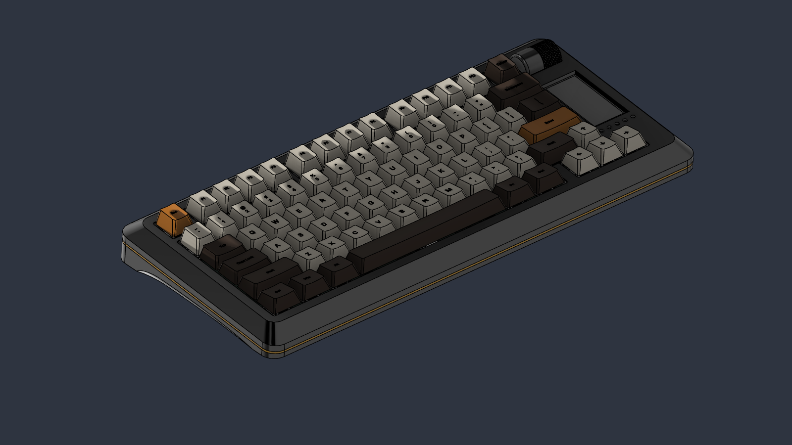

# Dachshund70 case (rev 2)

A gasket-mount aluminium case at 4°, with a brass weight in the bottom, an accent ring at the seam, a
2.13" e-paper screen and five status LEDs beside the knob, and a rotary knob on the right end. **The case is
designed in Fusion 360, and the Fusion model is the source of truth**, not the STEP files. The native
archive is `fusion/Dachshund70-Case-rev2.f3d`; the STEP, DXF and render files here are exports of it.

The first design (a CadQuery script, `gen_case.py`, at 7°) is gone: its geometry, files and renders were
replaced by this one. Git history has it.

## Files

| Folder | What |
| --- | --- |
| `fusion/Dachshund70-Case-rev2.f3d` | The Fusion archive: the full parametric model, with the boards, plate, battery, screen, knob and both keycap sets. Open it in Fusion to change anything |
| `fusion/scripts/` | The Python scripts that build the model and export these files (see "Rebuilding") |
| `step/` | STEP files, all in one frame (below), so they import on top of each other |
| `dxf/` | Flat DXFs for the ring (laser) and the weight's engraving (engraver) |
| `renders/` | Views of the model |
| `BOM.md` | Every part: material, finish, process, quantity, screws, gaskets, feet, the switch cap |

### `step/`

| File | What |
| --- | --- |
| `Dachshund70-Case-Top.step` | Top block (aluminium): the bezel, key opening, sock pockets, screen window, LED holes, encoder cutout and screw taps |
| `Dachshund70-Case-Bottom.step` | Bottom block (aluminium): the stepped floor, battery bay, USB-C opening, power switch slot, weight window and ledge pocket, rail pockets, screw holes |
| `Dachshund70-Case-Ring.step` | The accent ring (1.6 mm sheet) |
| `Dachshund70-Case-Weight.step` | The brass weight with its engraving |
| `Dachshund70-Case-Knob.step` | The knurled knob |
| `Dachshund70-Case-Encoder-Cover.step` | The cover over the encoder, tangent to the knob |
| `Dachshund70-Case-Switch-Cap.step` | The cap on the power switch's lever |
| `Dachshund70-Case-LED-Guide.step` | The light guide over the five status LEDs (3D printed) |
| `Dachshund70-Case-Assembly.step` | Everything: boards, plate, battery, screen, the keycaps with the 6.25 u spacebar, the case parts, screws and rails (64 MB, so import it with care) |
| `Dachshund70-Keycaps.step` | The keycap set with the split bottom row (1.25 u, 2.75 u and 2.25 u keys), in the assembly's frame |
| `Dachshund70-Keycaps-6.25u.step` | The keycap set with the 6.25 u spacebar (this is the one inside the assembly), in the same frame |

Every part is at its assembly position. The frame is Fusion's world frame: the desk is Z = 0, X runs along the
keyboard (X = 0 is the board's centre, KiCad x 178.25), Y points to the back and Z is up. The board and
the plate sit in it tilted 4° about X. In the board's own frame, KiCad x = local x + 178.25 and
KiCad y = 99.55 − local y.

### `dxf/`

- `Dachshund70-Case-Ring.dxf`: the ring flattened and seen from above, in mm at true size, with closed
  outlines only: layer `RING_OUTLINE` (the outside) and `RING_HOLES` (the opening, 8 screw holes and 12 joint
  slots). Lines, arcs and circles, no splines. Origin at the board's centre.
- `Dachshund70-Weight-Engraving.dxf`: the engraving as seen from below (the way it reads), in mm, origin at
  the centre of the weight's face: `DOG_SILHOUETTE` (the recess's outline), `DOG_DETAIL` (the ear, chest, leg
  grooves and eye) and `TEXT` ("Dachshund70" in Fredoka SemiBold, with the counters of a, d, D and 0 as inner loops). Closed
  polylines. The silhouette is 0.3 deep (flat floor), the grooves and eye 0.5 deep and the text 0.3.

## Key dimensions

- Typing angle: 4°, built into the case; the bottom is flat. The walls of every part are square to the plate
  (parallel to its normal), so the end, front and back faces lean with the board.
- Footprint: 347.9 × 155.2 mm in the plate's plane (X −173.8 to 174.1). Heights above the desk: the bottom
  block is 15.1 tall (Z 0 to 15.1), the top block 24.5 (Z 4.6 to 29.1 at the knob's hump); the bezel's top edge is
  9.9 above the desk at the front and 20.8 at the back.
- Accent ring: 1.6 mm sheet in a slot between the blocks, at local z −2.2 to −0.6 in the board's frame (its edge
  shows as a thin gold line round the case). Outline 347.9 × 155.2, opening 320 × 122.6.
- Mounting: the plate sits on twelve silicone gasket socks (8 × 5 × 5 mm) on its prongs, in pockets in the top
  block; 4 × M3 × 12 along the front and 4 × M3 × 20 along the back (countersunk, from below) hold the
  blocks together through the ring.
- Floor: stepped, one world-horizontal step per switch row under the keys (3.0 at the front to 7.9 at the back);
  flat and hollow under the screen and knob.
- Battery bay: pocket 35.1 × 57.1 under the screen and knob, floor at Z 1.2, for an EEMB LP803450 (52.0 × 34.5 × 8.3
  plus a 4.5 protection board) laid flat, its long side front to back.
- Weight: brass, face 185.0 × 30.6 (R4 corners), flange 216.0 × 46.5 (R5), 38.95 cm³ (brass 331 g). It drops
  in from inside through a window in the floor; its flange rests on stepped ledges at z 3.68, 5.01 and 6.34 and its
  top sits 0.1 under the floor. Four M3 × 5 countersunk screws from inside, in the local frame at
  (±103.5, 2.5) and (±103.5, 22.5), go into taps Ø2.5 × 3.8 deep. No screw heads show underneath.
- Knob and cover: Ø19.2 × 15.1 knurled knob on the encoder's 20 mm shaft; the cover's walls are tangent to it.
- Screen: GoodDisplay GDEY0213B74 on end beside the knob, behind a window with a 45° frame; five LEDs under it in
  an evenly spaced row, with a printed light guide.
- Power switch: a PCM12 slide switch on the USB-C daughterboard, its lever carrying a 3.4 × 2.0 cap that rides in a
  stadium slot in the back face (1.5 travel).
- USB-C: an opening in the back face, with the daughterboard on a ledge (2 M3 taps); the encoder module hangs
  from two M2 posts in the top block.
- Feet: two 300 × 5.8 × 2.0 rubber rails near the front and back edges, in 1.0 mm pockets.
- Part list: [BOM.md](BOM.md).

## Rebuilding and re-exporting

The scripts in `fusion/scripts/` drive Fusion's Python API. Each starts with a `REPO` path to edit (the repo
root, with a trailing slash). Run them from Fusion's Scripts dialog, or through the Fusion MCP's `script`
execute (each defines `run(_context)`).

- `build_case2.py`: clears the timeline and rebuilds every case part from parameters (the dict at the top, the
  plate outline's numbers and the floor steps). `place_models.py` and `make_models.py` import the board STEP
  files from `hardware/step/` and make the stand-ins (battery, screen, knob); `post_build.py` (`stage1()`,
  then `stage2()`, in one call after the build) imports the keycap files, builds the two spacebar sets and
  places everything at the 4° tilt. Don't create timeline items, appearances or planes after `stage2()`.
  The keycap sets it imports are `step/Dachshund70-Keycaps*.step`; they come from this model (the old CadQuery
  `keycaps.py` is gone), so a rebuild needs them in the repo as they are. The rebuild path from these scripts
  has not been re-run end to end since the files were moved here: the `.f3d` is the dependable copy.
- `export_all.py`: writes the part STEP files, the assembly, both keycap sets and the `.f3d`.
- `export_dxf.py`: writes the two DXFs.
- `shots.py`, `check_a.py`, `underside.py`: the camera helper and the clearance checks used while designing.
- `dog_proto.py` + `dog_outline.txt`: the dachshund outline's control points and a quick PIL preview of it.

After a board changes: run `python hardware/export_step.py` for the new board STEPs, rebuild (or move the
parts in Fusion), then re-export. The model's imported board occurrences are the ones to replace.

Not checked against real parts: sock squeeze, the plug lead-in against real cables, the screw-in stabilizers'
clearance, the switch cap's travel and fit on the PCM12 lever, the screen's real sizes (the panel's from
GoodDisplay's drawing; the picture's position along it is an estimate), the light guide against the plate's
LED windows, and the radio's range through the aluminium over the antenna.

## Display

A bare 2.13" e-paper panel (GoodDisplay GDEY0213B74, SSD1680, 250 × 122, black on white) standing on end
beside the knob: 29.2 × 59.2 mm, with a 23.7 × 48.6 mm picture. In portrait that's 120 × 248 pixels, 12 × 15
cells of text with the 10 × 16 font. Build the firmware with
`-DEXTRA_DTC_OVERLAY_FILE=displays/eink-2in13-v4-portrait.overlay`, which turns the picture in software.

- Driver: the panel needs a driver board. The model has Adafruit's eInk Breakout Friend (#4224, about
  34.7 × 21.5 mm) taped flat to the panel's back, its parts facing down. Waveshare's 2.13" V4 module (the same
  panel on a board) runs the same firmware, but its board is too big for the sidebar.
- Mount: the panel sits in a locating frame under the roof, behind a window with a 45° bevel, held by thin
  double-sided tape (0.2 mm, such as 3M 9448A or tesa 4965) on its border. The driver board's parts clear the
  plate by about 0.3 mm in the model, so check that with the real board.
- Wiring, from J4's holes (no header, since JLC doesn't fit it) to the Friend: 1 3V3 → VIN, 2 GND → GND, 3 DIN →
  MOSI, 4 CLK → SCK, 5 CS → ECS, 6 DC → D/C, 7 RST → RST, 8 BUSY → BUSY. The Friend's SRAM and SD card selects
  (SRCS, SDCS) stay unconnected; check that the board pulls them high. Route the wires flat along the plate's
  J4 slot to the board's front edge, about 80 mm long so the top block can lie upside down next to the board
  while you fit the screen.
- Refresh: e-paper keeps its picture with no power, and a refresh takes about a second, so the firmware redraws
  at most every 3 s (`CONFIG_KB_SCREEN_EPD_MIN_INTERVAL_MS`). That suits the layer, lock, battery and
  connection status it shows.
- The driver board stays clear of the radio module's antenna (KiCad x > 333, y 67–79 mm); only the panel's
  glass reaches over the antenna's left end.
- Sizes are nominal: measure your parts and correct the screen pocket in the Fusion model (`build_case2.py`)
  before machining. If the text comes out upside down, set `rotation = <270>` in the overlay.
- Other screens: Pimoroni's 1.12" 128 × 128 SH1107 OLED (overlay `oled-sh1107-128x128`, 8 text rows) fits the
  sidebar; OLED modules use J4 pins 1–4 (3V3, GND, DIN = SDA, CLK = SCL). They need a different pocket.

## Making it

- Top and bottom blocks: 6061-T6 aluminium, 3-axis CNC with a ball-end mill for the slopes, bead-blasted and
  anodised. The ring is laser-cut from 1.6 mm sheet from the DXF and anodised in the accent colour. The weight
  is brass (C360) with a polished face; steel, aluminium and titanium weigh 306, 105 and 173 g.
- Screws are tapped, not inserts. For a printed prototype open the holes to 4.2 mm for M3 × 4 heat-set
  inserts and print the blocks in pieces (each is 347.9 mm long).
- Antenna: the top block over the antenna stays aluminium. The ground plane under the keys and the metal over
  the antenna cost some range; a test with the real case is still needed, and a polycarbonate window in the
  roof over the antenna is the fallback.
- Battery: it stays more than 50 mm from the radio module; next to or under the antenna it would detune it.
